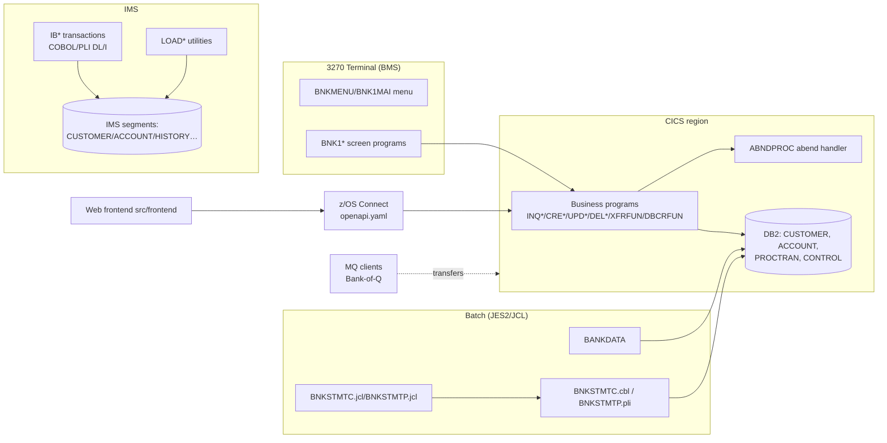
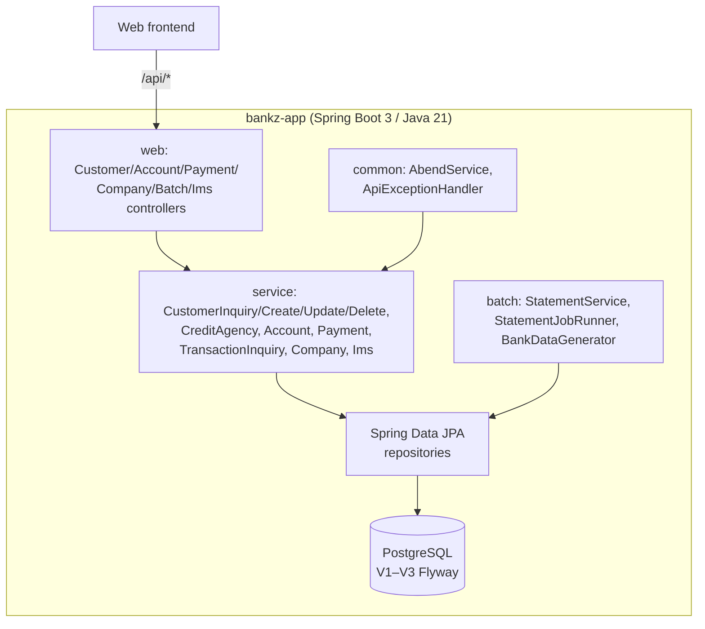

# Technical Documentation — Current State

## 1. Current-state architecture

## 2. Application component diagram (target, implemented)

## 3. Program dependency map (legacy, measured)

| Program | Calls/uses | Data |
|---|---|---|
| BNK1* screen pgms | LINK/XCTL to function programs; BMS send/receive | commarea |
| INQCUST | SORTCODE.cpy, INQCUSTZ.cpy, CUSTOMER.cpy, ABNDPROC | CUSTOMER (DB2) |
| CRECUST | CRDTAGY1–5, CRECUST.cpy, CUSTOMER.cpy | CUSTOMER, CONTROL |
| UPDCUST/DELCUS | copybooks | CUSTOMER (+ACCOUNT check) |
| INQACC/INQACCS/INQACCCU | ACCDB2.cpy | ACCOUNT |
| CREACC/UPDACC/DELACC | ACCTCTRL.cpy | ACCOUNT, CONTROL |
| DBCRFUN | HV-PROCTRAN | ACCOUNT, PROCTRAN |
| XFRFUN | eyecatchers, SYNCPOINT/ROLLBACK | ACCOUNT, PROCTRAN |
| INQTRAND/INQTRANL | PROCTRAN layout | PROCTRAN |
| GETCOMPY/GETSCODE | CONTROLI.cpy | CONTROL |
| ABNDPROC | ABNDINFO.cpy | — |
| BNKSTMTC/BNKSTMTP | statement spec | CUSTOMER, ACCOUNT, PROCTRAN |
| BANKDATA | sequential files | CUSTOMER, ACCOUNT, PROCTRAN |
| IB*/LOAD* (IMS) | PSBs IB*/IBLOAD, copybooks | IMS segments |

## 4. Data flow

1. 3270 user enters data in BMS field → screen program maps to commarea → LINKs to business program → `EXEC SQL` on DB2 → response commarea → BMS map back.
2. REST path: z/OS Connect maps JSON → commarea → same business programs (that is why the Java API could reuse `openapi.yaml` unchanged).
3. Batch: JCL executes `BNKSTMT*` which reads DB2 and writes SYSOUT statement.
4. IMS: transactions via MFS/DL/I against hierarchical segments; `LOAD*` programs seed from `ims/LoadData/*.data`.

## 5. Database structure

### DB2 (legacy)

| Table | Key | Key fields |
|---|---|---|
| CUSTOMER | (SORTCODE, CUSTOMER_NUMBER) | NAME, DOB, ADDRESS, CREDIT_SCORE, REVIEW_DATE |
| ACCOUNT | (SORTCODE, ACCOUNT_NUMBER) | CUSTOMER_NUMBER, TYPE, INTEREST_RATE, OVERDRAFT, ACTUAL_BALANCE, AVAILABLE_BALANCE, OPENED/LAST_STATEMENT |
| PROCTRAN | (SORTCODE, TRAN_NUMBER) | ACCOUNT_NUMBER, TYPE, DATE, AMOUNT, DESCRIPTION |
| CONTROL | SORTCODE | next customer/account numbers |

### IMS segments (DBD)

CUSTOMER, CUSTTYPE, ACCOUNT, ACCTYPE, CUSTACCS (customer↔accounts), HISTORY, TSTAT, TSTATTYP, TTYPE — flattened to relational tables in `V3__create_ims_tables.sql`.

### PostgreSQL (modern, implemented)

`customer`, `account`, `processed_transaction`, `control_table`, `ims_*` tables via Flyway `V1`–`V3`.

## 6. Entry points & execution flows

- CICS transactions: each business program is invoked by screen programs or REST mapping; `ABNDPROC` invoked on `EXEC CICS ABEND`.
- IMS: `IB*` transaction codes per `ims/PSB/*.asm`.
- Batch: `BNKSTMTC.jcl` → PGM=BNKSTMTC (COBOL) / `BNKSTMTP.jcl` → PGM=BNKSTMTP (PL/I).
- Modern: `BankzAppApplication` on port 8085; `/api/**` controllers; `/api/batch/*` replaces JCL.

## 7. Modernization challenges & risks

- Commarea binary layouts → JSON/DTO mapping (solved via response DTOs).
- `9999999999`/random semantics — preserved, tested.
- Credit-agency chain — consolidated into `CreditAgencyService` (5 checks retained).
- IMS hierarchical → relational (V3).
- No z/OS runtime → parity pending; demo data used.
- MQ path unconverted — flagged open.
