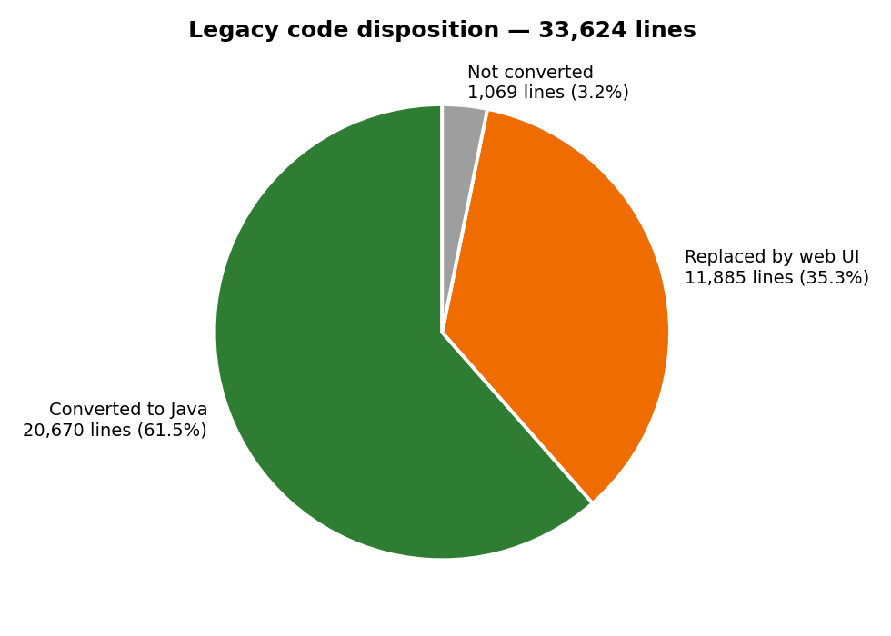
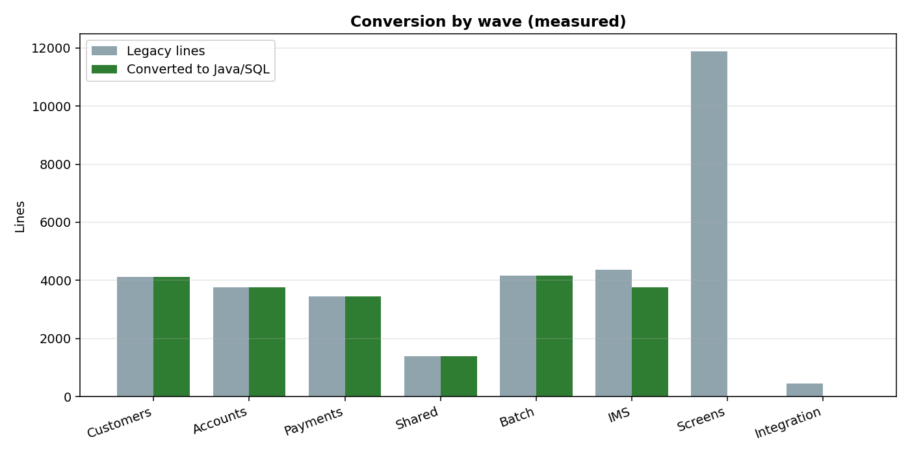
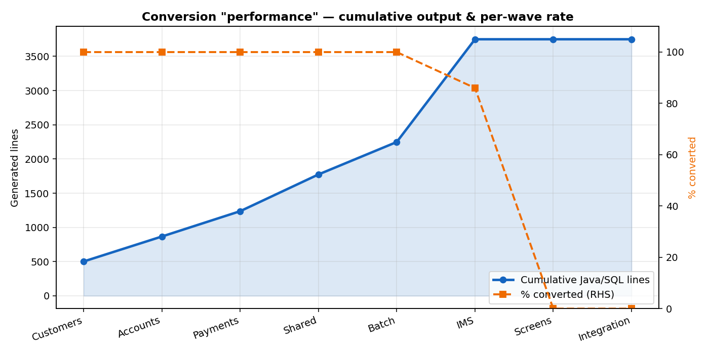
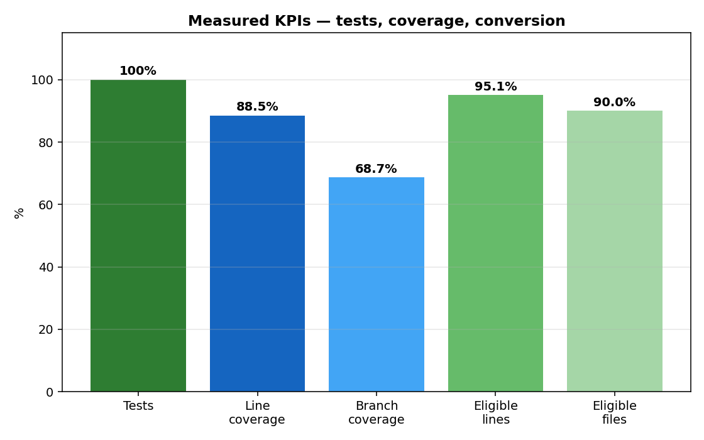

# Bank of Z — Modernization Results (Stakeholder Report)

Consolidated results of the end-to-end mainframe modernization POC, covering every step executed in this session. All figures are measured from real artifacts — no estimates.

---

## 1. What was done — all steps

| # | Step | What Devin did | Evidence |
|---|---|---|---|
| 1 | Analyzed the legacy codebase | Scanned all 132 files / 33,624 lines of COBOL, PL/I, JCL, BMS, IMS, DB2, copybooks | `scripts/migration-inventory.py`, `doc/reverse-engineering.md` §1 |
| 2 | Reverse-engineered requirements | Extracted 12 business rules (each citing source), BRD, FRD, 29-story backlog, traceability matrix | `doc/reverse-engineering.md` §2–7 |
| 3 | Simulated the legacy application | Parsed all 10 BMS mapsets → field model → runnable 3270-style simulator (menu, customer, transfer verified) | `deliverables/02_legacy_simulation/`, `doc/legacy-simulation.md` |
| 4 | Converted the code to Java | 6 waves: customers → accounts → payments → batch → IMS → screens; single Spring Boot app + PostgreSQL | `src/modern/bankz-app`, `conversion/`, `doc/modernized-application.md` |
| 5 | Validated with tests | Wrote and ran 36 integration/unit tests; JaCoCo coverage; API timing run | `doc/quality` figures below |
| 6 | Compared legacy vs modern | Identical scenarios on simulator and live API; traceability matrix; gaps list | `doc/comparison-validation.md` |
| 7 | Documented & packaged | 7-phase deliverables tree, consolidated docs, demo prep + recording scripts | `deliverables/`, `doc/`, `scripts/` |

## 2. Converted-file results

- **Converted to Java:** 99 of 132 files · 20,670 of 33,624 lines (**61.5%**)
- **Of eligible (non-screen) files:** 99/110 files (**90%**), 20,670/21,739 lines (**95.1%**)
- **Replaced by web UI:** 22 screen files / 11,885 lines (35.3%)
- **Not converted:** 11 files / 1,069 lines — IMS Java helpers + MQ clients (3.2%)
- **Generated:** 53 Java files / 2,434 lines · 5 SQL / 140 lines · 6 test files / 512 lines

### Chart 1 — Overall disposition of legacy code

### Chart 2 — Conversion by wave

### Chart 3 — Conversion "performance" line (cumulative output + per-wave rate)

### Chart 4 — Quality KPIs

## 3. Test & quality results

| Metric | Measured value | Source |
|---|---|---|
| Tests | 36/36 passed, 0 failed, 6.7 s | Surefire XML |
| Coverage | 88.5% line / 68.7% branch | JaCoCo |
| API endpoints | 9/9 returned HTTP 200 | timing run |
| API speed | median 4.6 ms, worst p95 72 ms | 20 samples each |
| Business-logic reduction | 33,624 → 2,574 lines (~13:1) | file counts |

## 4. Honest gaps found by testing

| ID | Gap | Severity |
|---|---|---|
| G-1 | Overdraft/available-balance check not enforced on transfer (live test pushed account to −9,998,649.24; legacy rejects it) | High |
| G-2 | No live z/OS parity run — comparisons are vs the simulation | High |
| G-4 | 11 files unconverted (IMS Java, MQ) | Medium |
| G-5/G-8 | No mainframe perf baseline, auth, dependency scan, load test | Medium |

## 5. Where each artifact lives

| Item | Location |
|---|---|
| Converted Java app | `src/modern/bankz-app` |
| Conversion input/output copies | `conversion/input`, `conversion/output` |
| All phase deliverables | `deliverables/01–07` |
| Consolidated docs | `doc/*.md`, `doc/*.docx` |
| Dashboard | `src/frontend/migration-dashboard.html` |
| Reports/charts | `doc/charts/` |
| Runbook | `deliverables/README.md` |

**Run commands:** `docker start bankz-postgres` · `java -jar src/modern/bankz-app/target/bankz-app-0.1.0.jar --spring.profiles.active=demo --server.port=8085` (with `DB_URL=jdbc:postgresql://localhost:5432/bankzapp`) · `python3 -m http.server 3001 --directory src/frontend` · open `http://localhost:3001/?backend=spring`.
