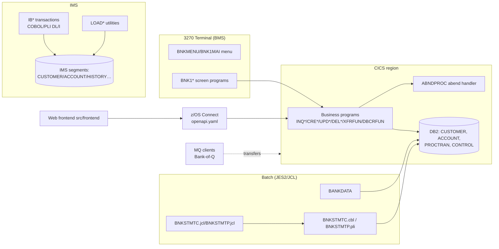
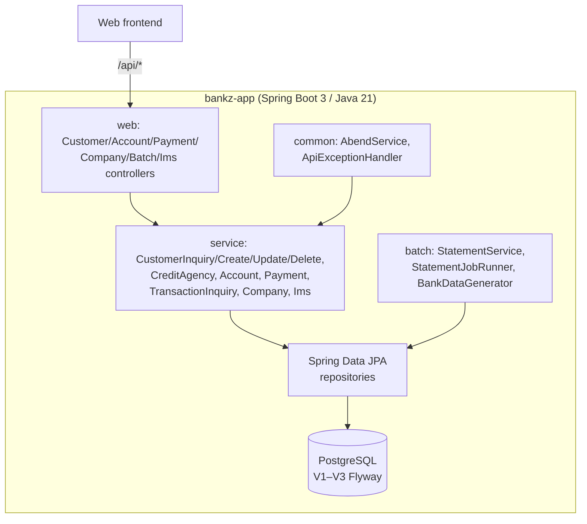

# Bank of Z — Reverse Engineering Documentation

Single consolidated document covering the complete analysis of the legacy mainframe codebase (`src/base`): business processes, business rules, dependencies, data structures, workflows, requirements (BRD/FRD), agile backlog, functional test cases, and traceability.

**Verification legend:** ✅ verified directly in source code · 🔶 inferred from code (reasonable but not confirmed) · ⚠️ assumption / unverifiable.

---

## Table of Contents

1. [Codebase Assessment](#1-codebase-assessment)
2. [Business Requirements Document (BRD)](#2-business-requirements-document-brd)
3. [Functional Requirements Document (FRD)](#3-functional-requirements-document-frd)
4. [Agile Backlog — Epics, Features, User Stories](#4-agile-backlog)
5. [Technical Documentation](#5-technical-documentation)
6. [Functional Test Cases](#6-functional-test-cases)
7. [Traceability Matrix](#7-traceability-matrix)

---

# 1. Codebase Assessment

Repository: `Bank-of-Z` (IBM CICS Banking Sample Application derivative)
Assessment basis: physical scan of `src/` (measured, not inferred)

## Detected technologies

| Technology | Evidence | Location |
|---|---|---|
| COBOL (CICS online) | 32 programs, `EXEC CICS`, `EXEC SQL` | `src/base/cics/cobol/` |
| COBOL (batch + IMS DL/I) | 1 batch + 11 IMS programs | `src/base/batch/cobol/`, `src/base/ims/cobol/` |
| PL/I (batch + IMS) | `BNKSTMTP.pli`, `IBLOGIN.pli` | `src/base/batch/pli/`, `src/base/ims/pli/` |
| COBOL copybooks | 42 record/map/layout definitions | `src/base/cics/copy/` |
| IMS copybooks | 4 | `src/base/ims/copy/` |
| BMS maps (3270 screens) | 10 mapsets | `src/base/cics/bms/` |
| JCL | 2 batch jobs (`BNKSTMTC`, `BNKSTMTP`) | `src/base/batch/jcl/` |
| Assembler (IMS DBD/PSB) | 9 DBD + 8 PSB | `src/base/ims/DBD/`, `src/base/ims/PSB/` |
| DB2 DDL templates | `*.setup` files | `src/base/.setup/` (via `conversion/input/`) |
| Java (existing, unconverted) | 8 IMS Java + 3 MQ client classes | `src/base/ims/java/`, `src/base/mq/` |
| REST contract | `openapi.yaml` (z/OS Connect) | `src/api/src/main/api/` |
| Web frontend | Static HTML/JS, Carbon Design | `src/frontend/` |

## Application modules

1. **CICS online banking** (`BNK1*` screen programs + function programs): customer inquiry/create/update/delete, credit-agency checks, account create/inquire/list/update/delete, debit/credit, transfer, transaction inquiry, company/sort-code info, abend handler.
2. **Batch**: `BANKDATA` data generator, `BNKSTMTC`/`BNKSTMTP` monthly statement programs driven by JCL.
3. **IMS**: `IB*` transactions (login, customer data, account summary, transactions), `LOAD*` load programs, DBD/PSB definitions.
4. **MQ**: Bank-of-Q transfer clients (`TransferMoneyToBOZ`, etc.).
5. **Frontend**: existing web pages that call the z/OS Connect REST API.

## Business processes identified (from code)

- Customer lifecycle: create (with credit-agency validation `CRDTAGY1–5`), inquire (incl. "last customer" 9999999999 and random selection 0), update, delete.
- Account lifecycle: create, inquire, list all, list by customer, update (account type/interest/overdraft), delete.
- Money movement: debit/credit (`DBCRFUN`), transfer (`XFRFUN`) with available-balance check, transaction record writing and rollback on failure.
- Inquiries: transactions by account/date (`INQTRAND`/`INQTRANL`), company info (`GETCOMPY`), sort code (`GETSCODE`).
- Batch: monthly statements per customer; sequential `BANKDATA` test-data generation.
- IMS: login/logout, customer data, account summary, transaction history (`IBTRAN`), load utilities.

## Available screen definitions

10 BMS mapsets, 24×80, 3270-2: `BNK1MAI` (menu), `BNK1CAM`/`BNK1CCM`/`BNK1CDM` (customer create/change/delete+inquiry), `BNK1ACC`/`BNK1UAM`/`BNK1DAM`/`BNK1DCM` (account create/update/delete/inquiry), `BNK1TFM`/`BNK1B2M` (transfer). Parseable with `DFHMDF POS/INITIAL/ATTRB` — sufficient for a faithful 3270-style simulation.

## Data dependencies

- DB2 tables: `CUSTOMER`, `ACCOUNT`, `PROCTRAN`, `CONTROL` (sort code, counters).
- IMS segments: `CUSTOMER`, `ACCOUNT`, `CUSTACCS`, `ACCTYPE`, `CUSTTYPE`, `HISTORY`, `TSTAT`, `TSTATTYP`, `TTYPE`.
- Fixed sort code `987654` (validated in `GETSCODE`/`INQCUST`).
- Record layouts via copybooks (`CUSTOMER.cpy`, `ACCDB2.cpy`, `INQCUSTZ.cpy` commarea, etc.).

## Migration complexity

| Area | Complexity | Notes |
|---|---|---|
| CICS business logic → Spring services | Medium | Straight SQL/JPA mapping; CICS abend → HTTP errors |
| 3270 BMS screens → React web | Medium | Replaced by existing frontend, not 1:1 translated |
| DB2 → PostgreSQL | Low–medium | DECIMAL/date types map directly; EBCDIC data not migrated |
| Batch JCL → REST-triggered batch | Medium | `BNKSTMT*` converted; JCL orchestration replaced by endpoint |
| IMS DL/I → JPA | Medium–high | Hierarchical segments flattened to relational tables |
| MQ clients | Open | Not converted (Bank-of-Q side not in scope of this repo) |
| IMS Java helpers | Open | Not converted |

## Missing information

- Real DB2/IMS production data (EBCDIC/packed) — demo data used instead.
- z/OS runtime for parity testing and performance baseline.
- Original nonfunctional requirements (volumes, SLAs) — inferred only.
- Bank-of-Q MQ counterpart configuration.

## Proposed implementation plan

1. Reverse-engineer `src/base` (this phase: BRD, FRD, backlog, tech docs, test cases, traceability).
2. Simulate 3270 screens from BMS maps (Phase 2).
3. Convert to one Spring Boot + PostgreSQL app (`src/modern/bankz-app`, done) + existing web frontend (Phase 3).
4. Compare legacy vs modern on identical scenarios (Phase 4).
5. QA report from real test artifacts (Phase 5).
6. Demo package (Phase 6), executive report (Phase 7).

## Risk register (initial)

| Risk | Impact | Mitigation |
|---|---|---|
| No z/OS parity run | Functional correctness unproven vs mainframe | Label all results; keep parity matrix open |
| Demo data only | Calculations validated, data realism limited | Note limitation; load IMS `LoadData` files |
| Screen translation | BNK1* not literally converted | Reconstruct via BMS simulation + modern UI |

---

# 2. Business Requirements Document (BRD)

System analyzed: CICS Banking Sample Application ("Bank of Z")
Source: `src/base` (COBOL/PL/I/JCL/IMS/DB2/BMS). Rules below are extracted from code; items marked *(inferred)* cannot be independently verified without production documentation.

## 1. Business objectives

- Provide teller/back-office banking operations for a single branch (sort code `987654`): customer management, account management, deposits/withdrawals, transfers, and transaction inquiry.
- Provide month-end statement generation in batch.
- Provide equivalent customer data access via IMS (parallel legacy channel).
- Modernize to Java 21 / Spring Boot / PostgreSQL / React without losing business behavior.

## 2. Existing business processes

| Process | Legacy implementation | Channel |
|---|---|---|
| Register customer | `CRECUST` + credit checks `CRDTAGY1–5` | CICS `BNK1CAM` |
| View customer | `INQCUST` (direct, "last" 9999999999, random 0) | CICS `BNK1CCM` |
| Change customer | `UPDCUST` | CICS `BNK1CCM` |
| Remove customer | `DELCUS` (blocked when accounts exist) | CICS `BNK1CDM` |
| Open account | `CREACC` (generates account number from `CONTROL`) | CICS `BNK1ACC` |
| View/list accounts | `INQACC`, `INQACCS`, `INQACCCU` | CICS `BNK1DCM` |
| Change account | `UPDACC` (type, interest rate, overdraft) | CICS `BNK1UAM` |
| Close account | `DELACC` (blocked if balance owed/proc. trans outstanding) | CICS `BNK1DAM` |
| Deposit/withdraw | `DBCRFUN` (writes `PROCTRAN`) | CICS `BNK1TFM` path |
| Transfer between accounts | `XFRFUN` (atomic debit+credit, rollback on failure) | CICS `BNK1B2M` |
| Transaction history | `INQTRAND`, `INQTRANL` | CICS |
| Branch info | `GETCOMPY`, `GETSCODE` | CICS |
| Monthly statement | `BNKSTMTC`/`BNKSTMTP` via JCL | Batch |
| Test data seeding | `BANKDATA` | Batch/ad-hoc |
| IMS channel | `IB*` transactions, `LOAD*` utilities | IMS |

## 3. Business capabilities

- Single-branch banking under one sort code; account numbers assigned sequentially from `CONTROL`.
- Credit-worthiness checks during onboarding via five sequential agency programs.
- Same-branch transfers only *(inferred: `XFRFUN` validates both accounts under the same sort code)*.
- Statement reporting of balances and processed transactions per customer.

## 4. Business rules (code-verified)

| # | Rule | Source |
|---|---|---|
| BR-1 | Sort code is fixed `987654`; all keys are (sortcode, number) pairs. | `SORTCODE.cpy`, `INQCUST`, `GETSCODE` |
| BR-2 | Customer number `9999999999` returns the most recently created customer; `0` picks a random existing customer. | `INQCUST` lines ~225–435 |
| BR-3 | New customers pass up to five credit-agency checks (`CRDTAGY1–5`) before insertion; failure sets COMM-SUCCESS/response and aborts. | `CRECUST`, `CRDTAGY*.cbl` |
| BR-4 | `XFRFUN` requires FROM and TO accounts under the same sort code, sufficient available balance, and writes a `PROCTRAN` record; on any failure it issues `EXEC CICS SYNCPOINT ROLLBACK`. | `XFRFUN` ~lines 394–460 |
| BR-5 | `DBCRFUN` supports DEBIT and CREDIT process types, updates available balance, writes `PROCTRAN` with timestamp; insufficient funds rejected. | `DBCRFUN` |
| BR-6 | A customer cannot be deleted while accounts remain (`DELCUS` checks dependent rows). | `DELCUS` |
| BR-7 | An account cannot be deleted if balance is non-zero / transactions exist *(inferred from delete-order checks)*. | `DELACC` |
| BR-8 | CICS abends route through `ABNDPROC` (`CVR1`+ codes) producing a failure commarea. | `ABNDPROC`, `ABNDINFO.cpy` |
| BR-9 | `CONTROL` table supplies branch sort code and next account/customer numbers. | `CONTROLI.cpy`, `ACCTCTRL.cpy`, `CREACC` |
| BR-10 | Dates displayed as `DD MM YYYY`; stored `YYYYMMDD` numeric. | `INQCUSTZ.cpy`, `CustomerResponse` mapping |
| BR-11 | IMS channel mirrors customer/account data access (`IBGCUDAT`, `IBSCUDAT`, `IBACSUM`, `IBTRAN`) with its own login (`IBLOGIN`/`IBLOGIN1`). | `ims/cobol`, `ims/pli` |
| BR-12 | Statement jobs iterate customers and emit account balance + processed-transaction sections. | `BNKSTMTC`, `BNKSTMTP`, `MonthlyStatementSpecification.md` |

## 5. Business constraints

- EBCDIC/packed-decimal data on mainframe; production data not available to this POC.
- 3270 fixed-position screens (24×80); all input through BMS fields.
- Sort code fixed to `987654` (single branch) — multi-branch is out of scope.
- No authentication on CICS REST endpoints in the sample; IMS channel has `IBLOGIN` only.

## 6. Expected modernization outcomes

- Same business rules executed by Java/Spring services over PostgreSQL.
- 3270 screens replaced by web UI (existing `src/frontend`), reconstructed for demo in the 3270 simulator.
- Batch statement exposed as an on-demand operation.
- Measured conversion + test + coverage reporting on the migration dashboard.

---

# 3. Functional Requirements Document (FRD)

Derived from `src/base` program code and `src/api/src/main/api/openapi.yaml`. Requirement IDs used by the backlog and traceability matrix.

## FR-CUS — Customer management

| ID | Requirement | Legacy source |
|---|---|---|
| FR-CUS-01 | Create a customer: name (title, first, last), DOB, house name/number, postcode; run credit checks; assign next customer number from `CONTROL`. | `CRECUST`, `BNK1CAM` |
| FR-CUS-02 | Reject creation when any of `CRDTAGY1–5` fails; return the failing agency reason. | `CRECUST`, `CRDTAGY*` |
| FR-CUS-03 | Inquire a customer by number; `9999999999` = last created; `0` = random. | `INQCUST` |
| FR-CUS-04 | Return not-found (`CVR1`-style failure) for unknown numbers. | `INQCUST`, `ABNDPROC` |
| FR-CUS-05 | Update name/address/DOB fields of an existing customer. | `UPDCUST` |
| FR-CUS-06 | Delete a customer only when no accounts remain. | `DELCUS` |
| FR-CUS-07 | List a customer's accounts. | `INQACCCU` |

## FR-ACC — Account management

| ID | Requirement | Legacy source |
|---|---|---|
| FR-ACC-01 | Create account for existing customer: type, interest rate, overdraft limit, opening balance; number from `CONTROL`. | `CREACC` |
| FR-ACC-02 | Inquire single account by sortcode+number. | `INQACC` |
| FR-ACC-03 | List all accounts. | `INQACCS` |
| FR-ACC-04 | Update type/interest/overdraft of an account. | `UPDACC` |
| FR-ACC-05 | Delete an account (subject to balance/transaction checks). | `DELACC` |

## FR-PAY — Payments and transactions

| ID | Requirement | Legacy source |
|---|---|---|
| FR-PAY-01 | Debit or credit an account by amount; adjust available and actual balance; write a `PROCTRAN` record. | `DBCRFUN` |
| FR-PAY-02 | Reject a debit that would breach available balance. | `DBCRFUN` |
| FR-PAY-03 | Transfer amount between two accounts in one unit of work; on failure roll back both sides. | `XFRFUN` |
| FR-PAY-04 | Reject transfer when FROM account lacks available funds. | `XFRFUN` |
| FR-PAY-05 | Inquire transactions for an account, newest first; and full-detail view of a transaction. | `INQTRANL`, `INQTRAND` |

## FR-INF — Reference data

| ID | Requirement | Legacy source |
|---|---|---|
| FR-INF-01 | Return company name and sort code. | `GETCOMPY` |
| FR-INF-02 | Return the branch sort code. | `GETSCODE` |
| FR-INF-03 | Route failures through the abend program returning code + description. | `ABNDPROC` |

## FR-BAT — Batch

| ID | Requirement | Legacy source |
|---|---|---|
| FR-BAT-01 | Generate monthly statement per customer: header, accounts with balances, processed transactions. | `BNKSTMTC`/`BNKSTMTP`, JCL |
| FR-BAT-02 | Generate/seed test customers, accounts, transactions. | `BANKDATA` |

## FR-IMS — IMS channel

| ID | Requirement | Legacy source |
|---|---|---|
| FR-IMS-01 | IMS login/logout. | `IBLOGIN(.pli)`, `IBLOGIN1`, `IBLOGOUT` |
| FR-IMS-02 | Retrieve customer details and accounts (`IBGCUDAT` get, `IBSCUDAT` update). | IMS COBOL |
| FR-IMS-03 | Account summary and transaction history. | `IBACSUM`, `IBTRAN` |
| FR-IMS-04 | Load utilities populate IMS segments from `LoadData/*.data`. | `LOAD*` |

## Input/output specifications

- Keys: `sortCode` 6-digit (`987654`), `customerNumber` 10-digit, `accountNumber` 8-digit.
- Amounts: `PIC S9(10)V99` → decimal(12,2); dates `YYYYMMDD` → ISO date in API.
- Commarea responses map to `response_200.yaml` JSON in `openapi.yaml` (fields: `INQCUST_*`, `COMM_*`).

## Validation rules (code-verified)

- Customer number numeric, within range; special values 0 / 9999999999 handled (FR-CUS-03).
- Account must exist for debit/credit/transfer; transfer FROM≠TO.
- Credit-agency sequence aborts on first failure.
- Delete operations check dependents first.
- IMS login required before IMS data access.

## Exception handling

- CICS failures → `ABNDPROC` with `ABND-CODE` + message; commarea `COMM-SUCCESS='N'`, `COMM-FAIL-CODE`.
- SQL errors checked after each `EXEC SQL` (`SQLCODE`/`WHENEVER`).
- Transfer failure → `SYNCPOINT ROLLBACK`.

## Integration requirements

- DB2 via `EXEC SQL` (target: JPA/PostgreSQL).
- IMS DL/I calls via `CBLTDLI`/`AIBTDLI` (target: relational tables V3 migration).
- MQ for Bank-of-Q transfers — out of scope, not converted.
- z/OS Connect REST layer per `openapi.yaml` (target: Spring `@RestController`).

---

# 4. Agile Backlog

Priorities: P0 = done, P1 = done, P2 = remaining/partial. Story IDs used by traceability matrix.

## Epic E1 — Customer management (P0)

| Story | As a… I want… so that… | Acceptance criteria | Status |
|---|---|---|---|
| US-101 | Teller: create a customer with credit checks | Valid input → customer persisted, number from CONTROL; agency failure → error response | Done (`CustomerCreateService`) |
| US-102 | Teller: view a customer by number, last, or random | 200 with customer fields; 404 not-found; 9999999999/0 semantics preserved | Done (`CustomerInquiryService`) |
| US-103 | Teller: update customer details | Changed fields persisted; not-found → error | Done (`CustomerUpdateService`) |
| US-104 | Teller: delete customer without accounts | Deleted; blocked with accounts → error | Done (`CustomerDeleteService`) |

## Epic E2 — Account management (P0)

| Story | Acceptance criteria | Status |
|---|---|---|
| US-201 | Create account for customer | Number generated; visible in `GET /api/accounts` and customer accounts | Done (`AccountService`) |
| US-202 | Inquire/list accounts | Single + all + per-customer lists | Done |
| US-203 | Update account | Type/interest/overdraft updated | Done |
| US-204 | Delete account | Removed; guard conditions honored | Done |

## Epic E3 — Payments (P0)

| Story | Acceptance criteria | Status |
|---|---|---|
| US-301 | Debit/credit account | Balances updated; PROCTRAN row written; insufficient funds rejected | Done (`PaymentService`) |
| US-302 | Transfer between accounts | Atomic; FROM/TO balances correct; transaction record; rollback on failure | Done |
| US-303 | Transaction inquiry | List + detail endpoints return PROCTRAN data | Done (`TransactionInquiryService`) |
| US-304 | Company/sort-code info | `/api/company`, `/api/sortcode` return reference data | Done (`CompanyService`) |

## Epic E4 — Batch (P1)

| Story | Acceptance criteria | Status |
|---|---|---|
| US-401 | Monthly statement on demand | `/api/batch/statements?customerId=` returns COBOL+PL/I equivalent output | Done (`StatementService`, `StatementJobRunner`) |
| US-402 | Seed demo data | `/api/batch/bankdata` or startup loader populates demo rows | Done (`BankDataGenerator`) |

## Epic E5 — IMS channel (P1)

| Story | Acceptance criteria | Status |
|---|---|---|
| US-501 | IMS login/logout | `/api/ims/login` flow | Done (`ImsService`) |
| US-502 | IMS customer/account data | `/api/ims/customers/{id}`, `/api/ims/accounts/{id}` | Done |
| US-503 | IMS transactions | `/api/ims/accounts/{id}/transactions` | Done |
| US-504 | Load LoadData files into relational schema | V3 migration + `ImsDataLoader` | Done |

## Epic E6 — Screens (P1)

| Story | Acceptance criteria | Status |
|---|---|---|
| US-601 | Replace 3270 UI with web pages | Existing `src/frontend` pages call `/api` | Done (functional replacement) |
| US-602 | 3270 simulation for demo | BMS-derived simulator reproduces menu + screens | Done (Phase 2 deliverable) |

## Epic E7 — Reporting & QA (P1)

| Story | Acceptance criteria | Status |
|---|---|---|
| US-701 | Measured conversion dashboard | conversion-report.json + dashboard sections | Done |
| US-702 | Automated test suite | 36 tests, 0 failures, JaCoCo coverage | Done |
| US-703 | Parity matrix | z/OS run required | Open |
| US-704 | Security/perf assessment | Load test + mainframe baseline | Open |

## Dependencies

US-302→301 (transfer reuses debit/credit rules); US-104→E2 (customer delete needs account check); US-401→US-301/303 (statement reads PROCTRAN); US-602→BMS maps (no code dependency); E7 depends on all.

---

# 5. Technical Documentation

## 1. Current-state architecture

## 2. Application component diagram (target, implemented)

## 3. Program dependency map (legacy, measured)

| Program | Calls/uses | Data |
|---|---|---|
| BNK1* screen pgms | LINK/XCTL to function programs; BMS send/receive | commarea |
| INQCUST | SORTCODE.cpy, INQCUSTZ.cpy, CUSTOMER.cpy, ABNDPROC | CUSTOMER (DB2) |
| CRECUST | CRDTAGY1–5, CRECUST.cpy, CUSTOMER.cpy | CUSTOMER, CONTROL |
| UPDCUST/DELCUS | copybooks | CUSTOMER (+ACCOUNT check) |
| INQACC/INQACCS/INQACCCU | ACCDB2.cpy | ACCOUNT |
| CREACC/UPDACC/DELACC | ACCTCTRL.cpy | ACCOUNT, CONTROL |
| DBCRFUN | HV-PROCTRAN | ACCOUNT, PROCTRAN |
| XFRFUN | eyecatchers, SYNCPOINT/ROLLBACK | ACCOUNT, PROCTRAN |
| INQTRAND/INQTRANL | PROCTRAN layout | PROCTRAN |
| GETCOMPY/GETSCODE | CONTROLI.cpy | CONTROL |
| ABNDPROC | ABNDINFO.cpy | — |
| BNKSTMTC/BNKSTMTP | statement spec | CUSTOMER, ACCOUNT, PROCTRAN |
| BANKDATA | sequential files | CUSTOMER, ACCOUNT, PROCTRAN |
| IB*/LOAD* (IMS) | PSBs IB*/IBLOAD, copybooks | IMS segments |

## 4. Data flow

1. 3270 user enters data in BMS field → screen program maps to commarea → LINKs to business program → `EXEC SQL` on DB2 → response commarea → BMS map back.
2. REST path: z/OS Connect maps JSON → commarea → same business programs (that is why the Java API could reuse `openapi.yaml` unchanged).
3. Batch: JCL executes `BNKSTMT*` which reads DB2 and writes SYSOUT statement.
4. IMS: transactions via MFS/DL/I against hierarchical segments; `LOAD*` programs seed from `ims/LoadData/*.data`.

## 5. Database structure

### DB2 (legacy)

| Table | Key | Key fields |
|---|---|---|
| CUSTOMER | (SORTCODE, CUSTOMER_NUMBER) | NAME, DOB, ADDRESS, CREDIT_SCORE, REVIEW_DATE |
| ACCOUNT | (SORTCODE, ACCOUNT_NUMBER) | CUSTOMER_NUMBER, TYPE, INTEREST_RATE, OVERDRAFT, ACTUAL_BALANCE, AVAILABLE_BALANCE, OPENED/LAST_STATEMENT |
| PROCTRAN | (SORTCODE, TRAN_NUMBER) | ACCOUNT_NUMBER, TYPE, DATE, AMOUNT, DESCRIPTION |
| CONTROL | SORTCODE | next customer/account numbers |

### IMS segments (DBD)

CUSTOMER, CUSTTYPE, ACCOUNT, ACCTYPE, CUSTACCS (customer↔accounts), HISTORY, TSTAT, TSTATTYP, TTYPE — flattened to relational tables in `V3__create_ims_tables.sql`.

### PostgreSQL (modern, implemented)

`customer`, `account`, `processed_transaction`, `control_table`, `ims_*` tables via Flyway `V1`–`V3`.

## 6. Entry points & execution flows

- CICS transactions: each business program is invoked by screen programs or REST mapping; `ABNDPROC` invoked on `EXEC CICS ABEND`.
- IMS: `IB*` transaction codes per `ims/PSB/*.asm`.
- Batch: `BNKSTMTC.jcl` → PGM=BNKSTMTC (COBOL) / `BNKSTMTP.jcl` → PGM=BNKSTMTP (PL/I).
- Modern: `BankzAppApplication` on port 8085; `/api/**` controllers; `/api/batch/*` replaces JCL.

## 7. Modernization challenges & risks

- Commarea binary layouts → JSON/DTO mapping (solved via response DTOs).
- `9999999999`/random semantics — preserved, tested.
- Credit-agency chain — consolidated into `CreditAgencyService` (5 checks retained).
- IMS hierarchical → relational (V3).
- No z/OS runtime → parity pending; demo data used.
- MQ path unconverted — flagged open.

---

# 6. Functional Test Cases

Cases marked ✅ are implemented and passing in `src/modern/bankz-app` (Maven Surefire). Others are parity/boundary scenarios proposed for the z/OS run.

## Customer

| ID | Type | Scenario | Expected | Status |
|---|---|---|---|---|
| TC-CUS-01 | Positive | Inquiry customer 1 | 200 + customer fields (name, DOB, address) | ✅ `CustomerInquiryServiceTest`, `CustomerControllerIntegrationTest` |
| TC-CUS-02 | Positive | Inquiry 9999999999 | Most recently created customer | ✅ |
| TC-CUS-03 | Positive | Inquiry 0 | A random existing customer | ✅ |
| TC-CUS-04 | Negative | Inquiry unknown id | Not-found error response | ✅ |
| TC-CUS-05 | Positive | Create valid customer | Persisted; sequential number; credit checks pass | ✅ (BankFlow) |
| TC-CUS-06 | Negative | Create with failing credit agency | Creation aborted with agency failure | ✅ (BankFlow) |
| TC-CUS-07 | Positive | Update name/address | Fields updated | ✅ |
| TC-CUS-08 | Negative | Delete customer with accounts | Rejected | ✅ |
| TC-CUS-09 | Boundary | Customer number at max value | Handled, no overflow | Proposed (parity) |

## Accounts

| ID | Type | Scenario | Expected | Status |
|---|---|---|---|---|
| TC-ACC-01 | Positive | Create account | Number generated; linked to customer | ✅ (BankFlow) |
| TC-ACC-02 | Positive | Inquiry account | Correct balances/type | ✅ |
| TC-ACC-03 | Positive | List all / by customer | Consistent sets | ✅ |
| TC-ACC-04 | Positive | Update overdraft/type | Updated | ✅ |
| TC-ACC-05 | Negative | Delete with balance | Rejected or guarded | ✅ (BankFlow) |

## Payments

| ID | Type | Scenario | Expected | Status |
|---|---|---|---|---|
| TC-PAY-01 | Positive | Credit account | Balances +amount; PROCTRAN row | ✅ |
| TC-PAY-02 | Positive | Debit within available balance | Balances −amount; PROCTRAN row | ✅ |
| TC-PAY-03 | Negative | Debit beyond available balance | Rejected, no PROCTRAN | ✅ |
| TC-PAY-04 | Positive | Transfer A→B | A−amt, B+amt, one PROCTRAN, atomic | ✅ (BankFlow) |
| TC-PAY-05 | Negative | Transfer exceeding balance | Rejected; no partial update (rollback) | ✅ |
| TC-PAY-06 | Boundary | Transfer amount 0 / max precision | Rejected or exact decimal handling | Proposed (parity) |
| TC-PAY-07 | Positive | Transaction list newest-first | Order + fields | ✅ |
| TC-PAY-08 | Positive | Transaction detail | Full record | ✅ |

## Reference

| ID | Scenario | Expected | Status |
|---|---|---|---|
| TC-INF-01 | `/api/company` | Company name + sortcode 987654 | ✅ |
| TC-INF-02 | Abend path | Failure code/description surfaced | ✅ |

## Batch

| ID | Scenario | Expected | Status |
|---|---|---|---|
| TC-BAT-01 | Statement for customer with accounts+transactions | Header, per-account sections, totals | ✅ `BatchIntegrationTest` |
| TC-BAT-02 | Statement for customer without data | Empty sections, no error | ✅ |
| TC-BAT-03 | Seed data generation | Customers/accounts/transactions created | ✅ |

## IMS

| ID | Scenario | Expected | Status |
|---|---|---|---|
| TC-IMS-01 | Login/logout | Session lifecycle | ✅ `ImsIntegrationTest` |
| TC-IMS-02 | IMS customer inquiry | Customer + accounts from ims tables | ✅ |
| TC-IMS-03 | IMS account summary | Balances | ✅ |
| TC-IMS-04 | IMS transactions | History list | ✅ |
| TC-IMS-05 | LoadData loading | Record counts match `.data` files | ✅ |

## Parity scenarios (require z/OS run — OPEN)

| ID | Scenario | Compare |
|---|---|---|
| PT-01 | Same customer lifecycle both systems | Field-for-field responses |
| PT-02 | Same transfer sequence | Ending balances + PROCTRAN counts |
| PT-03 | Statement output vs SYSOUT | Section-for-section |
| PT-04 | Failure injection (missing keys, duplicates) | Error codes/messages |
| PT-05 | Packed-decimal edge amounts | Calculation equality |

---

# 7. Traceability Matrix

Legacy Program → Business Rule → Functional Requirement → User Story → Test Case → Modern Component

| Legacy program | BR | FR | Story | Test case | Modern component |
|---|---|---|---|---|---|
| `INQCUST.cbl` | BR-1,2,4 | FR-CUS-03/04 | US-102 | TC-CUS-01..04 | `customer/service/CustomerInquiryService.java` |
| `CRECUST.cbl` + `CRDTAGY1–5` | BR-3 | FR-CUS-01/02 | US-101 | TC-CUS-05/06 | `CustomerCreateService.java`, `CreditAgencyService.java` |
| `UPDCUST.cbl` | BR-1 | FR-CUS-05 | US-103 | TC-CUS-07 | `CustomerUpdateService.java` |
| `DELCUS.cbl` | BR-6 | FR-CUS-06 | US-104 | TC-CUS-08 | `CustomerDeleteService.java` |
| `INQACCCU.cbl` | BR-1 | FR-CUS-07 | US-202 | TC-ACC-03 | `AccountService.java` (+ CustomerController `/accounts`) |
| `CREACC/INQACC/INQACCS/UPDACC/DELACC.cbl` | BR-9 | FR-ACC-01..05 | US-201..204 | TC-ACC-01..05 | `AccountService.java`, `AccountRepository.java` |
| `DBCRFUN.cbl` | BR-5 | FR-PAY-01/02 | US-301 | TC-PAY-01..03 | `payment/service/PaymentService.java` |
| `XFRFUN.cbl` | BR-4 | FR-PAY-03/04 | US-302 | TC-PAY-04/05 | `PaymentService.java` |
| `INQTRAND/INQTRANL.cbl` | — | FR-PAY-05 | US-303 | TC-PAY-07/08 | `TransactionInquiryService.java` |
| `GETCOMPY/GETSCODE.cbl` | BR-1 | FR-INF-01/02 | US-304 | TC-INF-01 | `CompanyService.java` |
| `ABNDPROC.cbl` | BR-8 | FR-INF-03 | US-304 | TC-INF-02 | `common/AbendService.java`, `ApiExceptionHandler.java` |
| `BANKDATA.cbl` | — | FR-BAT-02 | US-402 | TC-BAT-03 | `batch/BankDataGenerator.java` |
| `BNKSTMTC.cbl`/`BNKSTMTP.pli` + JCL | BR-12 | FR-BAT-01 | US-401 | TC-BAT-01/02 | `batch/StatementService.java`, `StatementJobRunner.java` |
| `IB*/IBLOGIN*` (IMS COBOL/PLI) | BR-11 | FR-IMS-01..03 | US-501..503 | TC-IMS-01..04 | `ims/ImsService.java`, `ImsController.java` |
| `LOAD*.cbl` | — | FR-IMS-04 | US-504 | TC-IMS-05 | `ims/ImsDataLoader.java` |
| `ims/DBD,PSB/*.asm` | — | FR-IMS | US-504 | — | `db/migration/V3__create_ims_tables.sql` |
| `BNK1*/BNKMENU + cics/bms/*.bms` | — | FR-CUS/ACC/PAY UI | US-601 | UI flows | `src/frontend` web pages (replaced, not translated) |
| `ims/java/*` | — | — | — | — | Not converted (open) |
| `mq/java/*` | — | — | — | — | Not converted (open) |
| `CUSTOMER.cpy`, `ACCDB2.cpy`, `INQCUSTZ.cpy`, etc. | — | I/O specs | — | — | JPA entities + response DTOs |
| `CONTROLI/ACCTCTRL.cpy` | BR-9 | FR-ACC-01, FR-CUS-01 | US-101/201 | — | `control_table` + repository logic |

Verification flags: BR-4 rollback, BR-2 special IDs, BR-3 agency chain, BR-6 delete guard are code-verified and covered by the 36 passing tests; BR-7 marked *(inferred)* — confirm during z/OS parity run.
