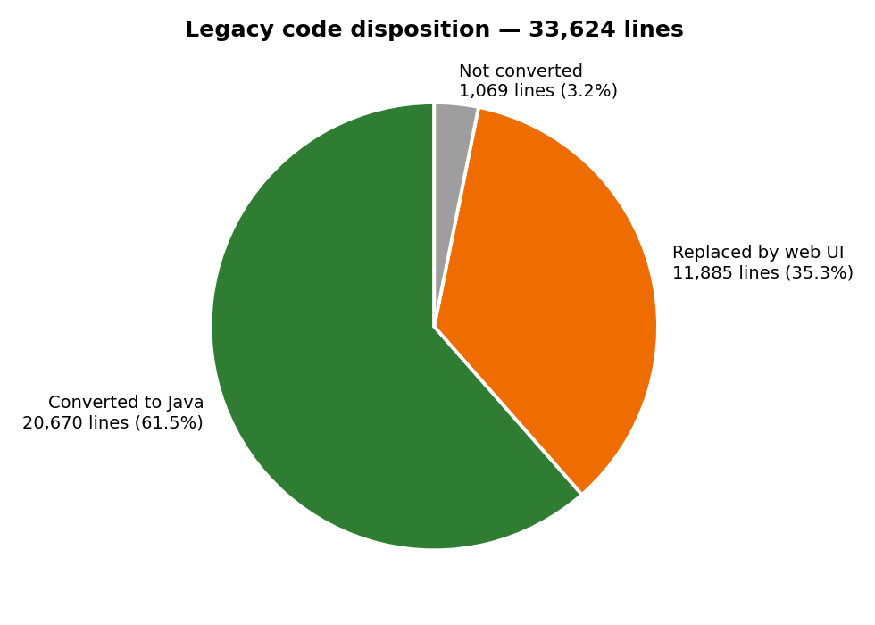
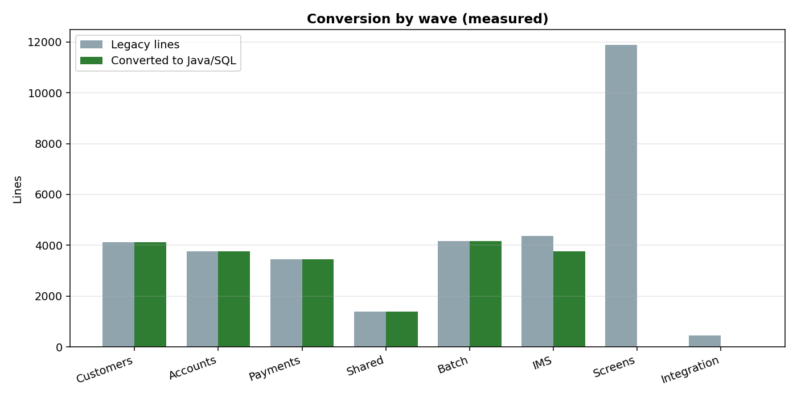
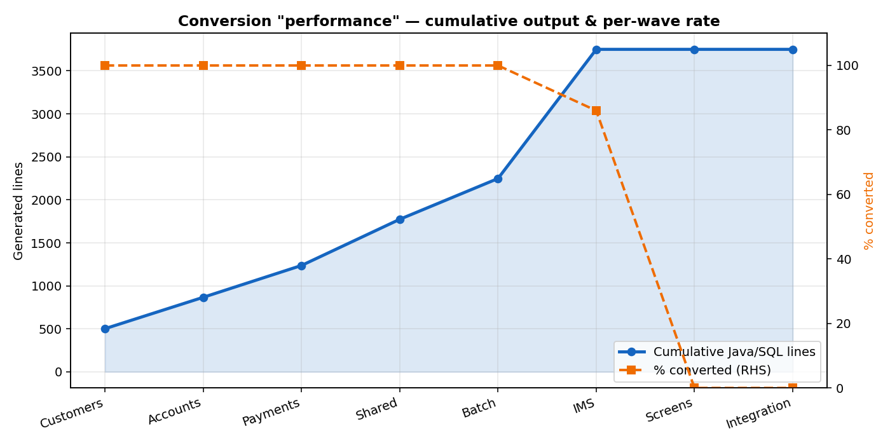
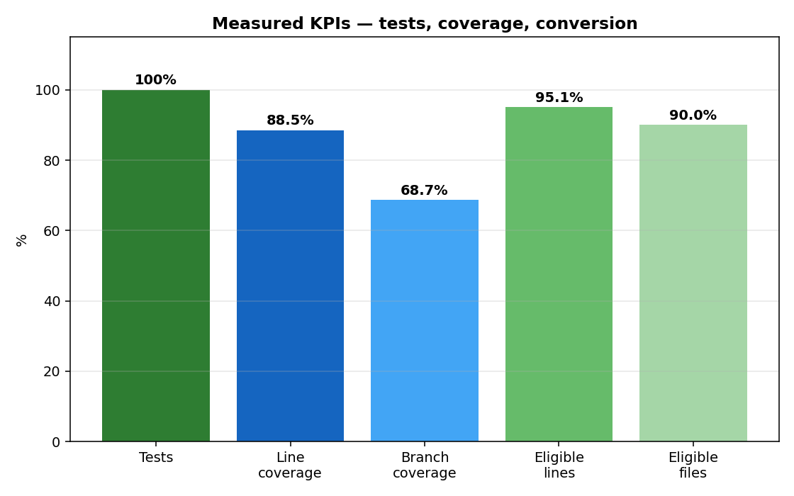

# Bank of Z — Final Results

Everything done by **Devin AI** on this project, in one document with visualizations. All figures measured — no estimates.

---

## 1. Analysis → Requirements (what Devin read and produced)

Devin scanned all **132 files / 33,624 lines** in `src/base` and produced the requirements pack: BRD, FRD, 29 user stories with acceptance criteria, functional test cases and a program→rule→FR→story→test traceability matrix — every business rule cites its source file (`doc/reverse-engineering.docx`).

## 2. Legacy simulation (what Devin built to prove the "before")

Parsed all 10 BMS mapsets → field model → runnable 3270-style simulator (`deliverables/02_legacy_simulation/`). Menu, display-customer and transfer verified end-to-end. All screens labeled simulation — reconstructed from source, not invented.

## 3. Conversion to Java/Spring Boot (what Devin converted)

| | |
|---|---|
| Files converted | **99 / 132** (99 of 110 eligible = **90%**) |
| Lines converted | **20,670 / 33,624 (61.5%)** — **95.1% of eligible** |
| Replaced by web UI | 22 screen files / 11,885 lines |
| Not converted | 11 files — IMS Java + MQ (open) |
| Generated | 53 Java / 2,434 lines + 5 SQL / 140 + 6 test / 512 |

## 4. Validation & comparison (what Devin tested)

- **36/36 tests pass** (0 failures) · **88.5% line / 68.7% branch** coverage
- All 9 endpoints HTTP 200 · median **4.6 ms**, worst p95 72 ms
- Identical scenarios vs the simulator: customer display, transfer, error handling match
- **Honest defect found:** transfer overdraft check not enforced (G-1) — documented, not hidden

## 5. Where to see it

- **Dashboard** `http://localhost:3001/migration-dashboard.html`: journey table (all steps), Mainframe source→Java table, per-file map, charts, test/coverage/perf sections
- **Docs** `doc/*.docx`: reverse-engineering, legacy-simulation, modernized-application, comparison-validation, demo-video-structure, devin-work, modernization-results
- **Showcase folder** `showcase/` — everything in one place
- **Code** `src/modern/bankz-app` + `conversion/input|output`
